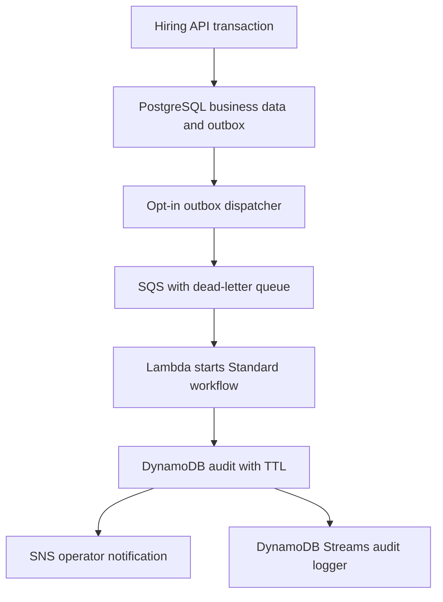

# AWS coursework upgrade - offline preparation

Prepared for ANKURALPHA and sohomsarkar2006-rgb from the BCSE355L Cloud Architecture
Design syllabus (version 2.0, supplied PDF pages 1-2). Review date: 30 October 2026.

## Current state and scope

This upgrade changes source and prepares infrastructure definitions. **No AWS
resource is created, started, resized, deleted, or upgraded by the smoke suite.**
All 17 CloudFormation templates default `EnableResources=false`; every resource
has an effective false condition. Workload consumers, monitoring schedules and
paid lab acknowledgements have their own disabled defaults. Importing Python
modules or running `tools/build_aws_templates.py` only reads/writes local files.

The last owner-supplied shutdown log reported every EC2 instance stopped. This
upgrade does not independently establish current live AWS state. An actual cloud
smoke test would require authenticated AWS access and possibly billable resources;
it was deliberately excluded from the offline test. The new alerts are prepared,
not active. Existing account resources and alerts are untouched.

Do not apply every template. These are composable teaching/reference stacks,
**not a stack migration command for the existing `jobtracker-demo` deployment**.
Do not create `compute-reference` alongside the retained host. Review/import or
reuse its inventory first during a separately requested future deployment.

## What actually runs in the application

When `AWS_EVENTS_ENABLED=false`, hiring operations run as before without cloud
delivery. Database migrations add an unused outbox table. No SQS worker starts by
default. When deliberately enabled later:



Events contain only a schema version, generated event UUID, timestamp, event
type, numeric job/application IDs and allowed status. Names, email addresses,
resumes, passwords and tokens are rejected from cloud events. Synthetic data is
used in smoke tests. This does not make the hiring application's PostgreSQL
personal data anonymous; its access/retention remains an operator responsibility.

The outbox uses a database transaction, a bounded lease, `FOR UPDATE SKIP LOCKED`,
backoff, a twelve-attempt local dead-letter limit and bounded cleanup. If a send
succeeds but its database acknowledgement fails, it may be sent again. The
Standard workflow name/input is deterministic, and DynamoDB conditionally writes
an event once. SNS delivery itself can duplicate; there is no exactly-once email
claim. A failed durable workflow requires operator inspection/redrive, with a
CloudWatch alarm prepared for it. Keep dead-letter alarms subscribed when enabled.

The main API gets an admin-only `/operations/events` endpoint; security headers,
request IDs, bounded login throttling, safer input parsing, additive migrations,
liveness and graceful shutdown are included. Request bodies, credentials and
candidate records are not intentionally logged by the new event pipeline.
Managed PostgreSQL can use `DATABASE_SSL=true` plus a trusted
`DATABASE_SSL_CA_FILE`; certificate checks stay enabled and URL SSL overrides are
rejected in that mode. This does not claim a live RDS connection was tested.

## Template inventory and dependencies

| Template | Purpose | Requirements before deliberately enabling |
|---|---|---|
| `network.json` | Two AZs; public/private subnets, routes, security groups, S3 gateway endpoint | New lab CIDRs must not overlap existing networks |
| `storage.json` | Private encrypted/versioned backups and longer archive lifecycle | Retention/deletion policies reviewed; no production data by accident |
| `identity.json` | Scoped S3/SQS/SSM role and instance profile | Existing bucket and queue ARN; verify SSM agent channel permissions |
| `integration.json` | SQS/DLQ, Lambda, Standard workflow, DynamoDB/Streams, SNS, failure alarms | Review account quotas, region support; consumers remain separately disabled |
| `credit-monitor.json` | Free-plan credit alerts, expiry checks, optional gross budget | Confirm alert email; schedule separately enabled; reuse existing budget |
| `observability.json` | Basic host alarms, retained seven-day logs, read-only SSM diagnostic document; optional management trail | Existing instance/topic; avoid duplicating trails |
| `cloudfront.json` | Private S3/OAC frontend and HTTPS API origin; no API caching | Valid HTTPS origin and uploaded frontend build; optional WAF ARN |
| `compute-reference.json` | Encrypted gp3, IMDSv2, role credentials, standard T3 CPU credits | **Reference only**: operator-selected AMI/subnet/group/profile; no app bootstrap is embedded |
| `ha-lab.json` | Two-AZ ALB/Auto Scaling, TLS listener, capacity zero | Prepared stateless app AMI, ACM certificate, database/network review; all ASG capacities start at zero |
| `rds-lab.json` | Private encrypted PostgreSQL, optional Multi-AZ/replica | Migration, credentials/Secrets Manager costs, tested recovery, explicit cost acceptance |
| `aurora-lab.json` | Private encrypted Aurora PostgreSQL alternative | Not deployed together with RDS; explicit higher-cost review |
| `efs-lab.json` | Encrypted private NFS and non-root access point | Real need for shared files; IAM-authorized TLS mount and cost review |
| `kms-lab.json` | Rotating customer KMS key | Monthly key fee and recovery/access design accepted |
| `peering-lab.json` | Same-account peering and both routes | Distinct VPCs, non-overlapping CIDRs, scoped SGs; transfer costs reviewed |
| `waf-lab.json` | Managed common rules and IP rate limit | Costs accepted; CloudFront scope in us-east-1; attach ARN explicitly and test false positives |
| `config-lab.json` | Narrow AWS Config recording and rules | Check existing recorder/delivery bucket and recording/evaluation costs |
| `dms-lab.json` | Private PostgreSQL full-load/CDC task definition | Secrets access role, trusted certificates, endpoint/network tests; never starts a migration task automatically |

The default single-host deployment stays the preferred future cost baseline. The
private subnets in the network reference have **no NAT**. A private HA app needs a
baked AMI and a reviewed egress/SSM design (endpoints or another approved path).
The network reference alone does not promise working private-instance management.
EFS is not a PostgreSQL data-volume replacement. ALB scaling must use an external
database and immutable stateless app nodes; a local container database cannot be
shared correctly by multiple app hosts.

SSM channel actions and several discovery/billing APIs lack resource-level ARNs.
Those scoped action sets use `Resource: "*"`; parameter/object/table/topic permissions
use project ARNs. No administrator policy, static IAM access key, public SSH rule,
NAT gateway, Elastic IP allocation, reservation or Marketplace purchase is added.
Standard SSM SecureString parameters using `alias/aws/ssm` can use the default
account key policy. A custom KMS key requires a separately reviewed key grant.

`aws/cloudwatch-agent.example.json` prepares two five-minute host metrics and a
sanitized operations log source, but does not install an agent or start the host.
Collection can consume account-wide free allowances and credits; seven-day log
retention does not remove the cost of initial ingestion.

## Smoke locally without AWS

Use Node.js 22+, pnpm 10.34.9, Python 3.12+, boto3, pytest and cfn-lint. For NixOS,
the repository has a shell with no startup/deployment hook:

```bash
nix develop
pnpm --dir backend install --frozen-lockfile
pnpm --dir frontend install --frozen-lockfile
python3 tools/smoke.py
```

Without Nix, use a private virtual environment, install
`aws/requirements-dev.lock`, install both pnpm lockfiles and run the same command.
Dependency downloads are network access; the test suite does not use live AWS.

The suite runs real embedded PostgreSQL (PGlite), temporary loopback HTTP and
fake SQS/AWS clients. It covers the admin/candidate workflow, unauthorized access,
blocked signup, transaction rollback, queue outage/retry, poison events, inactive
mode, repeatable migrations, retention, credit thresholds/expiry, failed SNS
delivery, duplicate messages, default resource conditions, CloudFormation schema
in Mumbai and us-east-1, and the frontend production build. It writes a
`smoke-results.json` receipt with source hash and actual exit codes.

It does not prove AWS account permissions, service quotas, Free plan eligibility,
real SNS confirmation/delivery, CloudFront DNS/TLS, RDS connectivity, real AWS
database restore, Docker image build, measured HA, availability SLA, RPO or RTO.
Do not present a prepared template or fake-client test as a deployed feature.

GitHub CI runs these offline checks with `contents: read`, no OIDC permission,
no AWS secrets, no deployment job and no action that starts EC2.
Actions are pinned to verified upstream commit SHAs; dependency updates remain
reviewable pull requests. A network-dependent dependency audit is a separate
release check, not a claim that the offline suite contacts an advisory service.
The root, backend and frontend each keep their independent lockfile context;
their pnpm settings require a 24-hour package release age. No package is exempted
to get a fresh dependency past that check.
Frontend dependency scripts are explicitly allowlisted for the esbuild builder;
the optional tsParticles install script is declined. The smoke command calls the
installed Node test runner and Vite binary directly, so a package manager cannot
silently reinstall dependencies or rewrite locks during an offline test.

## Read-only account checks, when the owner chooses

`tools/aws_ops.py plan` is entirely local. Its only other commands are read-only:

```bash
python3 tools/aws_ops.py credits --expected-account YOUR_12_DIGIT_ACCOUNT_ID
python3 tools/aws_ops.py audit-off --expected-account YOUR_12_DIGIT_ACCOUNT_ID
```

Both validate the AWS account. An expired session is an error rather than an
automatic root login or credential creation. `audit-off` checks all enabled
regions; a denied/unavailable region prevents a complete verification claim.
Exit 2 indicates alerts/findings and exit 1 an unknown/error result. This is not
an audit of every billable AWS service.

## Future deployment boundary

When hosting is requested again: first inspect current account/credits, retained
instance/volumes, existing budgets, quotas and the pre-update backup. Then reuse
the existing host and enable only the selected integrations. Keep all paid labs
disabled unless their specific need, current price and account eligibility have
been reviewed. Do not combine a Free-to-Paid plan upgrade with deployment.

Preserve the existing private login files, handover archive, state and recovery
objects. This source upgrade does not rotate passwords or contain those files.
